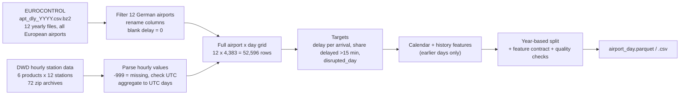

# Data: sources, processing and dataset description

This document describes where every column in `data/processed/airport_day.csv` comes from and how it was computed. The code that does all of this is in `pipeline/`; running

```bash
python -m pipeline download   # fetch the 84 raw files (about 134 MB) into data/raw/
python -m pipeline build      # build data/processed/ from data/raw/
```

reproduces the dataset exactly. We checked this: the rebuilt `airport_day.parquet` is identical to the one used in the notebooks and the rebuilt CSV has the same MD5 checksum.



## 1. Sources

| # | Source | Provider | What we use | Files | Access |
|---|---|---|---|---|---|
| 1 | Airport arrival ATFM delays, daily (`apt_dly_<year>.csv.bz2`) | EUROCONTROL, Aviation Intelligence Portal / Performance Review Unit | Daily IFR arrivals, total ATFM airport arrival delay, delay by cause (16 cause codes), arrivals delayed and arrivals delayed more than 15 min | 2014 to 2025, one file per year | Public, no login: `https://www.eurocontrol.int/performance/data/download/csv/apt_dly_<year>.csv.bz2` |
| 2 | Hourly station observations, historical (`stundenwerte_<product>_<station>_..._hist.zip`) | Deutscher Wetterdienst (DWD), Climate Data Center open data | Air temperature and humidity (TU), wind (FF), precipitation (RR), visibility (VV), maximum gust (FX), present weather codes (WW) | 6 products x 12 stations | Public, no login: `https://opendata.dwd.de/climate_environment/CDC/observations_germany/climate/hourly/` |
| 3 | German national public holidays | Computed in code (fixed dates + Easter-based dates) | `is_public_holiday` | none | n/a |

Every downloaded file is listed in `data/source_manifest.json` with its URL, size, SHA-256 hash and retrieval time (all retrieved on 30 September 2026). The raw files are not stored in this repository; `python -m pipeline download` fetches them and refuses to continue if a file changed since it was registered.

Terms of use: DWD open data in the CDC area is published under CC BY 4.0 with attribution to Deutscher Wetterdienst ([terms](https://opendata.dwd.de/climate_environment/CDC/Terms_of_use.pdf)). EUROCONTROL data is credited to EUROCONTROL / ansperformance.eu; we did not find a separate licence statement for the CSV downloads, so check EUROCONTROL's current terms before redistributing the raw files. The definitions behind the EUROCONTROL columns are on [ansperformance.eu](https://ansperformance.eu/definition/atfm-delay/) and the [airport arrival ATFM delay page](https://ansperformance.eu/capacity/atfm_apt).

### Airports and weather stations

Each airport is matched to the DWD synoptic station located at the airport. The pipeline computes the distance from the station coordinates (DWD metadata) to the airport reference point and fails if any station is more than 10 km away.

| ICAO | Airport | DWD station | Station name | Distance (km) |
|---|---|---|---|---:|
| EDDF | Frankfurt | 01420 | Frankfurt/Main | 3.62 |
| EDDM | Munich | 01262 | München-Flughafen | 2.13 |
| EDDL | Düsseldorf | 01078 | Düsseldorf | 0.73 |
| EDDH | Hamburg | 01975 | Hamburg-Fuhlsbüttel | 0.31 |
| EDDK | Cologne-Bonn | 02667 | Köln/Bonn | 1.05 |
| EDDS | Stuttgart | 04931 | Stuttgart-Echterdingen | 0.21 |
| EDDP | Leipzig-Halle | 02932 | Leipzig/Halle | 0.29 |
| EDDV | Hannover | 02014 | Hannover | 0.61 |
| EDDN | Nuremberg | 03668 | Nürnberg | 1.74 |
| EDDW | Bremen | 00691 | Bremen | 0.81 |
| EDDC | Dresden | 01048 | Dresden-Klotzsche | 1.06 |
| EDDG | Münster-Osnabrück | 01766 | Münster/Osnabrück | 0.83 |

Berlin is not included because its traffic moved from Tegel to the new BER airport in 2020, which would break the time series.

## 2. EUROCONTROL processing (`load_eurocontrol`)

1. **Read** each yearly bz2 file. The 2025 file mixes UTF-8 and Latin-1 encodings in 2,190 lines (airport names only), so lines are decoded one by one, falling back to Latin-1.
2. **Check the schema**: the column list must match exactly, otherwise the build stops.
3. **Filter** to the 12 airports. Each yearly file has about 99,000 to 101,000 rows for all reporting airports; 4,364 to 4,392 rows per year are kept.
4. **Parse dates** (`FLT_DATE`) as UTC calendar days. Exact duplicate airport-days are dropped; conflicting duplicates would stop the build (none occurred).
5. **Rename** the source columns:

| Source column | Dataset column |
|---|---|
| `FLT_ARR_1` | `arrivals` (IFR arrivals) |
| `DLY_APT_ARR_1` | `atfm_delay_min` (total ATFM airport arrival delay, minutes) |
| `FLT_ARR_1_DLY` | `arrivals_atfm_delayed` |
| `FLT_ARR_1_DLY_15` | `arrivals_atfm_delayed_15` (delayed more than 15 min) |
| `DLY_APT_ARR_<code>_1` | `delay_<cause>_min`, one column per cause code: A accident, C ATC capacity, D de-icing, E equipment (non-ATC), G aerodrome capacity, I ATC industrial action, M airspace management, N industrial action (non-ATC), O other, P special event, R ATC routeing, S ATC staffing, T equipment (ATC), V environment, W weather, NA not specified |
| `ATFM_VERSION` | `atfm_version` (v1 until mid-2016, v2 afterwards) |

6. **Blank delay cells mean zero.** Before 2023 the source leaves a delay cell empty when no ATFM delay was recorded; from 2023 it writes explicit zeros. Blanks are set to 0 and flagged in `delay_blank_in_source`. After this step the 16 cause columns add up exactly to `atfm_delay_min` on every row.
7. 38 airport-days have no EUROCONTROL record at all (`eurocontrol_row_present = False`). They are kept as rows with missing traffic and delay values, not filled.

## 3. DWD weather processing (`parse_dwd`, `daily_weather`)

1. **Read** the single `produkt_*` file inside each zip (Latin-1, semicolon separated) and check its header against the expected columns.
2. **Check the time zone**: the DWD parameter metadata in each zip must state UTC for every variable over 2014 to 2025, otherwise the build stops.
3. **Clean**: `-999` becomes missing. Exact duplicate hours are dropped; conflicting duplicates stop the build.
4. **Align** all six products on one complete hourly UTC grid (105,192 hours, 2014-01-01 00:00 to 2025-12-31 23:00). Nothing is filled or interpolated.
5. **Aggregate to UTC days.** A daily value is only kept if the variable has at least 20 valid hours that day; otherwise it is missing.

| Column | Rule (hourly to daily) |
|---|---|
| `temp_mean_c`, `temp_min_c`, `temp_max_c` | mean, min, max of hourly air temperature (°C) |
| `frost_day` | `temp_min_c <= 0` |
| `rh_mean_pct` | mean relative humidity (%) |
| `wind_mean_ms`, `wind_max_ms` | mean and max of hourly mean wind speed (m/s) |
| `gust_max_ms` | max hourly gust FX_911 (m/s) |
| `gust_hours_ge15` | hours with gust >= 15 m/s |
| `precip_sum_mm`, `precip_max_1h_mm` | daily sum and max hourly precipitation (mm) |
| `precip_hours` | hours with >= 0.1 mm |
| `cold_precip_hours` | hours with >= 0.1 mm and temperature <= 1 °C (snow/ice proxy) |
| `vis_min_m` | minimum hourly visibility (m) |
| `low_vis_hours_lt1000`, `vis_hours_lt5000` | hours with visibility < 1,000 m and < 5,000 m |
| `fog_hours`, `thunder_hours`, `snow_hours`, `freezing_hours` | hours whose present-weather code falls in the group below |
| `*_valid_hours`, `ww_reported_hours` | number of valid hours behind each aggregate (quality fields, not predictors) |

Present-weather code groups (WMO code table 4677 for observer codes 00 to 99, table 4680 for automatic codes, stored by DWD as 100 to 199):

| Group | Codes |
|---|---|
| fog | 28, 40 to 49, 120, 130 to 135 |
| thunder | 17, 29, 91 to 99, 126, 190 to 196 |
| snow | 22, 23, 26, 36 to 39, 68 to 79, 83 to 88, 124, 127, 167, 168, 170 to 178, 185 to 187 |
| freezing | 24, 56, 57, 66, 67, 125, 154 to 156, 164 to 166 |

Code `-1` (not reported) counts as no event.

## 4. Building the airport-day table (`build`)

1. **Grid**: every combination of the 12 airports and the 4,383 days from 2014-01-01 to 2025-12-31 (52,596 rows). EUROCONTROL and weather data are left-joined onto it, so no airport-day is lost and gaps stay visible as missing values.
2. **Rates** (only where arrivals > 0):
   - `atfm_delay_per_arrival = atfm_delay_min / arrivals`
   - `share_arrivals_delayed_15 = arrivals_atfm_delayed_15 / arrivals`
   - `weather_delay_per_arrival = delay_weather_min / arrivals`
3. **Labels** (missing when arrivals are missing or zero, 47 rows):
   - `disrupted_day = 1` if `share_arrivals_delayed_15 >= 0.02`, the main classification target (6.2% of labelled days)
   - `severe_disrupted_day = 1` if the share is >= 0.10
   - `any_atfm_delay_day = 1` if `atfm_delay_min > 0`
   - `weather_atfm_day = 1` if `delay_weather_min > 0`
4. **Calendar**: `weekday` (Monday = 0), `month`, `doy_sin` and `doy_cos` (day of year on a circle, period 365.25), `is_weekend`, `is_public_holiday` (New Year, Good Friday, Easter Monday, 1 May, Ascension, Whit Monday, 3 October, 25 and 26 December), `year`, and `covid_traffic_period` (15 March 2020 to 31 December 2021, kept for analysis only, not used as a model input).
5. **History features**, computed per airport from days strictly before the row's day (`shift(1)` before any rolling window), so they are known at the start of the day:
   - `arrivals_lag1`, `arrivals_lag7`, `arrivals_mean_7d` (at least 5 of 7 days)
   - `delay_per_arrival_lag1`, `share_delayed15_lag1`, `disrupted_lag1`
   - `delay_per_arrival_mean_7d` (at least 5 of 7 days), `delay_per_arrival_mean_28d`, `disrupted_rate_28d`, `weather_delay_per_arrival_mean_28d` (at least 20 of 28 days)
6. **Split by date**: train 2014 to 2021, `model_select` 2022, `calibrate` 2023, test 2024 to 2025.

## 5. Feature contract and checks

`data/processed/feature_contract.json` lists the 37 columns the models may use (7 known in advance, 20 same-day weather, 10 history) and the same-day outcome columns they must never use (today's arrivals, delays, shares and all labels). The notebooks read the predictor list from this file.

Same-day weather is the observed weather, used as if it were a perfect day-ahead forecast. Model scores are therefore an upper bound for a real forecasting setup.

The build stops or reports a failure unless all of these hold (results in `data/processed/data_quality.json` and `data_quality.md`): one row per airport-day and 52,596 rows in total; every row has a split; every label agrees with its rule; no forbidden column is in the predictor list; `arrivals_lag1` equals the previous day's `arrivals`; every split contains both classes; every station is within 10 km of its airport.

## 6. Missing values

| Columns | Missing rows (of 52,596) | Reason |
|---|---:|---|
| `arrivals`, delay columns | 38 | no EUROCONTROL record for that airport-day |
| `disrupted_day` and other labels | 47 | the 38 above plus 9 days with zero arrivals |
| temperature, `frost_day` | 185 | fewer than 20 valid hours |
| `rh_mean_pct` | 197 | same |
| wind | 304 | same |
| gusts | 321 | same |
| precipitation | 192 | same |
| visibility | 754 | same (Stuttgart has the most gaps) |
| fog, thunder, snow, freezing hours | 826 | same |
| history features | 50 to 281 | start of the series and after gaps |

Missing values are left as missing in the dataset. The model notebooks fill them with training-period medians (linear models) or pass them to LightGBM natively; the BI notebooks leave weather-missing days out of weather comparisons.

## 7. Column list

The CSV has 79 columns:

- Keys and identifiers: `airport_icao`, `date`, `airport_name`, `dwd_station`, `year`, `split`
- EUROCONTROL: `arrivals`, `atfm_delay_min`, `arrivals_atfm_delayed`, `arrivals_atfm_delayed_15`, `atfm_version`, 16 `delay_<cause>_min` columns, `delay_blank_in_source`, `eurocontrol_row_present`
- Weather: the columns in section 3, including the `*_valid_hours` quality fields
- Derived rates and labels: `atfm_delay_per_arrival`, `share_arrivals_delayed_15`, `weather_delay_per_arrival`, `disrupted_day`, `severe_disrupted_day`, `any_atfm_delay_day`, `weather_atfm_day`
- Calendar: `weekday`, `month`, `doy_sin`, `doy_cos`, `is_weekend`, `is_public_holiday`, `covid_traffic_period`
- History: the 10 columns in section 4.5

## 8. Things to keep in mind

- ATFM delay is delay caused by air traffic flow management regulations. It is not the same as airline punctuality.
- EUROCONTROL changed its ATFM delay calculation with Network Manager release 20.0 in April 2016 (`atfm_version` v1 to v2), so 2014 to early 2016 is not perfectly comparable with later years.
- Before 2023 a blank delay cell means no delay was recorded; we treat it as zero.
- Dresden, Münster-Osnabrück, Nuremberg and Hannover almost never have ATFM delay (2 to 34 disrupted days in 12 years), so per-airport results there are not meaningful.
- 2020 and 2021 (COVID) are part of the training period.
